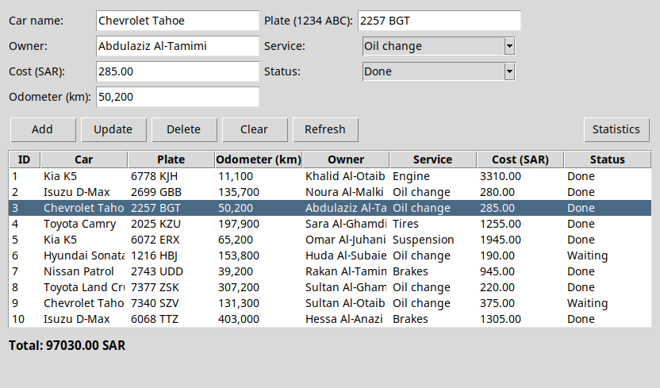
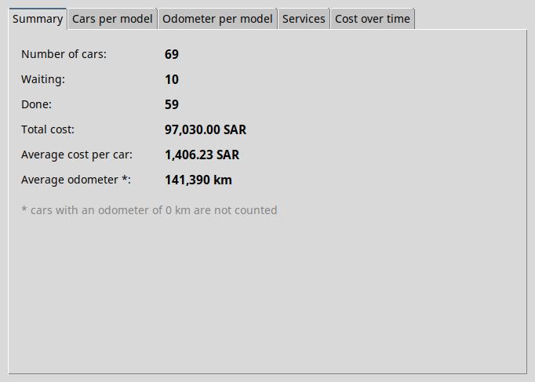
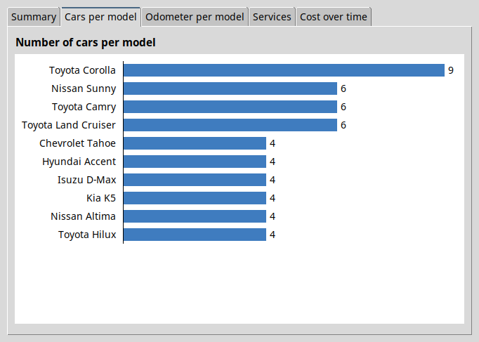
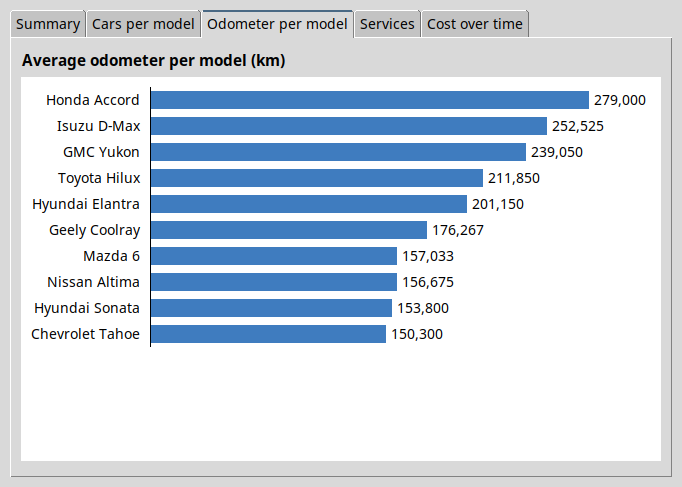
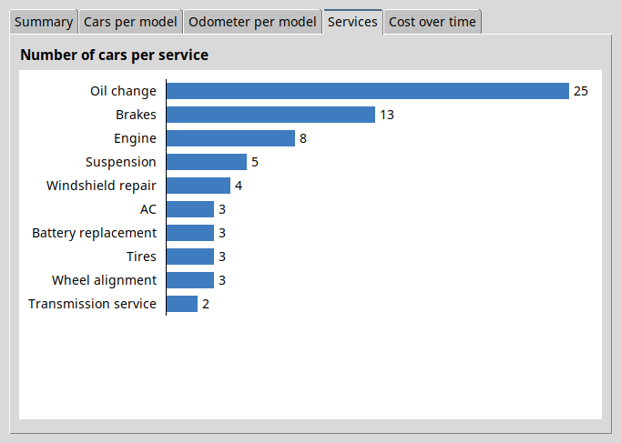
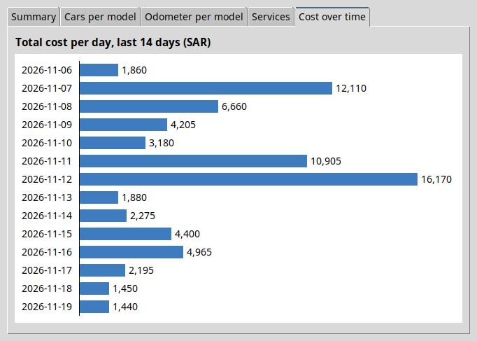

# 🔧 Car Workshop Service Log

**Trade the paper notebook for a real service desk.**
A desktop app that lets a small car workshop log every car that rolls in, track what was done
to it, see what's still waiting, and know exactly how much money came through the door — all
from one window, with live charts one click away.




---

## ✨ Why it's useful

Plenty of small workshops still write cars on paper: the note gets lost, nobody remembers if the
Camry's oil change is done, and the end-of-day total is done on a calculator. This app fixes that:

- 📋 **Every car in one table** — model, Saudi license plate, odometer, owner, service, cost and status.
- ➕ **Add, edit and delete in seconds** — click a row and the form fills itself; delete asks before it removes anything.
- 🟢 **Waiting / Done status** — see at a glance which cars are still in the bay.
- 💰 **Live running total** — the total cost of all services, in SAR, always visible under the table.
- 📊 **Statistics window** — a summary plus four bar charts, drawn with plain Tkinter (no extra libraries).
- 🧾 **Text report** — a background thread pulls every car from the server and writes `report.txt`.
- 🛡️ **Careful input checks** — bad plates, letters in the cost, impossible odometers: each one gets a clear, friendly error.
- 💾 **Nothing gets lost** — data lives in SQLite, so stopping and restarting the server keeps every record.

## 📊 Statistics at a glance

Click **Statistics** and a new window opens with five tabs.

| Summary | Cars per model |
|---|---|
|  |  |
| **Average odometer per model** | **Cars per service** |
|  |  |

**Cost over time** — how much the workshop earned each day for the last 14 days that have cars:



| Tab | What it shows |
|---|---|
| Summary | number of cars, Waiting / Done, total cost, average cost, average odometer |
| Cars per model | how many cars of each model (upper/lower case ignored), top 10 |
| Odometer per model | average km per model, top 10 (cars with 0 km are left out) |
| Services | how many cars had each service |
| Cost over time | total cost per day for the last 14 days that have cars |

The charts are horizontal bar charts drawn on a Tkinter `Canvas`. Every label gets its own line
on the left, so long model names never overlap, and very long ones are cut with "…".

## 🏗️ How it works

Three parts talk to each other:

```
Tkinter (src/client.py)  --HTTP-->  Flask (src/server.py)  --SQL-->  SQLite (src/cars.db)
                         <--JSON--                         <--rows--
```

- The **window** (`client.py`) never touches the database. It sends HTTP requests and shows the JSON replies.
- The **server** (`server.py`) checks every input, then asks `CarDB` to do the SQL work.
- The **database layer** (`database.py`) opens one connection per call, uses `?` placeholders, commits and closes.
- The **report** (`report.py`) runs in its own thread and writes `src/report.txt`.

```
Final_project/
├── src/
│   ├── database.py      # class CarDB - all SQLite work
│   ├── server.py        # Flask routes + input checks (port 5050)
│   ├── client.py        # Tkinter window + HTTP requests
│   ├── stats_window.py  # Statistics window with bar charts
│   └── report.py        # thread that writes report.txt
├── docs/screenshots/    # images used in this README
├── requirements.txt     # flask
├── README.md
└── PLAN.md
```

## 🚀 Getting started

**1. Install** (only Flask is needed; everything else is Python's standard library):

```bash
python -m venv venv
source venv/bin/activate        # Windows: venv\Scripts\activate
pip install -r requirements.txt
```

**2. Run** — start the server first, then the window:

```bash
python src/server.py      # terminal 1 - Flask on port 5050
python src/client.py      # terminal 2 - the app window
python src/report.py      # terminal 3 (optional) - writes src/report.txt
```

**3. There is no step 3.** The database `src/cars.db` and its table are created automatically
the first time the server starts (`CREATE TABLE IF NOT EXISTS`), so existing records are always kept.

## 📝 Using the app

- **License plate** uses the Saudi format: 1-4 numbers, a space, then 3 English letters, like `1234 ABC`.
  Typing `1234abc` is fine — it is saved as `1234 ABC`.
- **Odometer** is a whole number of km from 0 to 2,000,000. Commas are allowed (`120,000`), and the table shows them too.
- **Cost** is in SAR, from 0 to 100,000.
- **Service** has a list of common jobs. Pick **Other** and a popup lets you type your own
  (for example `Windshield repair`, up to 40 characters). Cancel keeps the service you had before.
- Each car keeps the date it was added (`created_at`), which feeds the cost-over-time chart. Editing a car keeps its date.

<details>
<summary><b>Upgrading an older <code>cars.db</code></b></summary>

When the server starts, `CarDB.createTable()` upgrades old databases in place:

- no `plate` or `odometer` column → added (old cars get an empty plate and 0 km)
- an old `mileage` column → renamed to `odometer`, values kept
- no `created_at` column → added, old cars are dated today

</details>

## 🌐 API routes

| Method | Route                       | What it does                     | Replies          |
|--------|-----------------------------|----------------------------------|------------------|
| GET    | `/cars`                     | all cars (used by the window and report) | 200      |
| GET    | `/cars/<car_id>`            | one car                          | 200 / 404        |
| POST   | `/cars/add`                 | add a car                        | 201 / 400        |
| POST   | `/cars/<car_id>/edit`       | edit a car                       | 200 / 400 / 404  |
| POST   | `/cars/<car_id>/delete`     | delete a car                     | 200 / 404        |
| GET    | `/total`                    | extra feature: total cost        | 200              |
| GET    | `/stats`                    | extra feature: statistics        | 200              |

### One request traced (Add)

1. The user fills the inputs and clicks **Add**. This calls `WorkshopApp.addCar()`.
2. `getFormValues()` builds a dict, and `sendRequest()` encodes it with `urlencode` and POSTs
   it to `http://127.0.0.1:5050/cars/add` using `urlopen(..., timeout=5)`.
3. Flask's `addCar()` reads `request.form` and calls `checkCarForm()`. Bad values give JSON
   `{"error": ...}` with status 400.
4. Good values go to `CarDB.add()`, which runs `INSERT ... VALUES (?, ?, ?, ?, ?, ?, ?)`, commits and closes.
5. Flask replies `{"message": "Car added"}` (201). The window shows the message and reloads the table and total.

## 🎓 Course topic locations

| Topic | Where |
|---|---|
| Python & collections | `src/database.py` `CarDB.getAll()` (list of dicts), `src/client.py` `WorkshopApp.getFormValues()` (dict), `WorkshopApp.loadCars()` (loop), `src/server.py` `checkCarForm()` (loop over dict) |
| Exceptions | `src/server.py` `checkCarForm()` (`ValueError`) and every route (`sqlite3.Error`), `src/client.py` `sendRequest()` (`HTTPError` / `URLError` / `socket.timeout`), `src/report.py` `writeReport()` (`OSError`) |
| Classes | `src/database.py` `CarDB`, `src/client.py` `WorkshopApp` |
| SQLite | `src/database.py` `CarDB` methods (`?` placeholders, one connection per call, commit, close) |
| Threads & files | `src/report.py` `main()` (`Thread`, `start()`, `join()`) + `writeReport()` (`with open(..., encoding="utf-8")`) |
| Charts (Tkinter Canvas) | `src/stats_window.py` `StatsWindow` (Notebook tabs) + `drawBarChart()` |
| SQL aggregates | `src/database.py` `CarDB.getStats()` (`COUNT`, `SUM`, `AVG`, `GROUP BY`) |
| Tkinter | `src/client.py` `WorkshopApp` (labels, entries, comboboxes, buttons, Treeview, messagebox, simpledialog in `onServiceSelect()`) |
| Client & server | `src/client.py` `WorkshopApp.addCar()` → `sendRequest("/cars/add", values)` → `src/server.py` `addCar()` → `CarDB.add()` → JSON `{"message": "Car added"}` |
| Flask | `src/server.py` routes + `checkCarForm()` + `jsonify` replies |

**Naming style:** variables and parameters in `snake_case` (`car_name`, `selected_id`),
functions and methods in `camelCase` (`sendRequest`, `checkCarForm`), classes in `PascalCase` (`CarDB`, `WorkshopApp`).

## ✅ Test results

Every case below was checked against a running server.

| Test | Result |
|---|---|
| Fresh clone → follow README → app runs | Pass |
| Add, view, edit, delete work; only the chosen record changes | Pass |
| Delete asks for confirmation (yes/no box) | Pass |
| Stop and restart Flask → records still there | Pass |
| Empty car name → "Car name is required" | Pass |
| Cost `abc` → "Cost must be a number" | Pass |
| Plate `ABC 123` or `12345 ABC` → "Plate must be 1-4 numbers then 3 letters, like 1234 ABC" | Pass |
| Plate typed as `4321abc` → saved as `4321 ABC` | Pass |
| Service **Other** → popup; typed `Windshield repair` is saved and shown in the table | Pass |
| Service **Other** → Cancel or empty text → service goes back to the previous choice | Pass |
| Typed service longer than 40 characters → "Service must be 40 characters or less" | Pass |
| Odometer empty / `abc` / `12.5` / `-1` / `2000001` → clear error each time | Pass |
| Odometer `120,000` → saved as 120000, shown as `120,000`; edit keeps the other fields | Pass |
| Old `cars.db` with a `mileage` column → renamed to `odometer`, values kept | Pass |
| Old `cars.db` without a plate column → column added on start, old cars keep their data | Pass |
| Cost `-5` → "Cost must be between 0 and 100000" | Pass |
| Empty database → table shows "No cars yet", total 0.00 | Pass |
| Unknown ID: same car selected in two windows, deleted in one, edited in the other → "Car not found" (404) | Pass |
| Update/Delete with no row selected → "Please select a car first" | Pass |
| Stop Flask, Refresh → "Cannot connect to the server. Is Flask running?"; start Flask, Refresh → works without restarting the window | Pass |
| **Statistics** → summary + 4 charts (cars per model, odometer per model, services, cost per day) | Pass |
| Statistics with an empty database → zeros and "No data yet" in every chart | Pass |
| ` Toyota` and `toyota` → one model "Toyota" in the charts | Pass |
| 70 cars, 10 models / 10 services / 14 days → every chart label readable, no overlap; very long names cut with "…" | Pass |
| Old `cars.db` without `created_at` → column added, old cars dated today | Pass |
| `python src/report.py` → `report.txt` with correct cars and total | Pass |
| `report.py` with Flask stopped → clear connection error | Pass |

The GUI tests were run by calling the window's methods from a test script against a running
server, with the popup boxes replaced. Please also click through them by hand once before the demo.

## 🙏 Credits

- Built with Python's standard library and [Flask](https://flask.palletsprojects.com/) — nothing else.
- The code and this README were written with AI assistance (Claude by Anthropic), following
  the project plan in `PLAN.md`. Check the course academic integrity policy on AI tools and
  declare this use as it requires.
- Screenshots use made-up sample data (names, plates and costs are not real customers).
